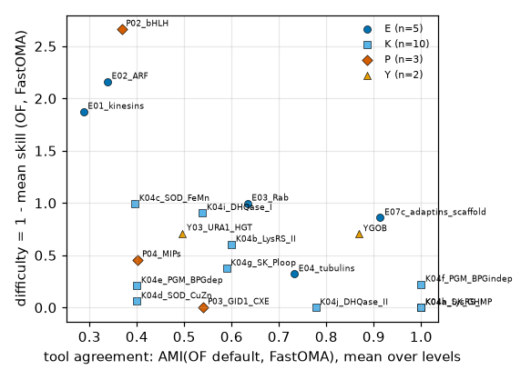

# Family difficulty and tool agreement

difficulty = 1 - mean skill over OF default and FastOMA declared on the primary endpoints defined for the item (skill unbounded below, so difficulty > 1 occurs when tools are worse than the best trivial baseline). AMI = adjusted mutual information of the two tools' HOG partitions of reference-tree genes (genes without a HOG at a level = singletons); family level and mean over levels. Collections: unit means. Generated by scripts/analysis/difficulty.py.

Headline items with both quantities: n=20; Spearman rho(difficulty, AMI mean over levels) = -0.58 (p=0.0077); rho(difficulty, AMI family level) = -0.53 (p=0.017).

Ranking below: non-control items (headline flag shown); control-track items (K01 RPROT units, K02, E05) only in difficulty.tsv.

| rank | item | panel | track | headline | difficulty | mean skill (n values) | AMI family level | AMI mean levels | OF/FO bcubed | OF/FO merge acc | OF/FO event rec | OF/FO membership |
|---|---|---|---|---|---|---|---|---|---|---|---|---|
| 1 | P02_bHLH | P | family | 1 | 2.665 | -1.665 (2) | 0.000 | 0.368 | 0.991/1.000 | 0.999/1.000 | NA/NA | 0.364/0.018 |
| 2 | E02_ARF | E | family | 1 | 2.162 | -1.162 (8) | 0.104 | 0.338 | 0.956/0.760 | 0.717/0.291 | 0.000/0.000 | 0.768/0.417 |
| 3 | E01_kinesins | E | family | 1 | 1.875 | -0.875 (8) | 0.125 | 0.288 | 0.985/0.935 | 0.515/0.270 | 0.500/0.000 | 0.607/0.366 |
| 4 | E07b_adaptins_medium_small | E | family | 0 | 1.814 | -0.814 (6) | 0.601 | 0.768 | 0.958/0.924 | 0.743/0.709 | 0.000/0.000 | NA/NA |
| 5 | E07a_adaptins_large | E | family | 0 | 1.800 | -0.800 (6) | 0.790 | 0.930 | 0.983/0.967 | 0.754/0.593 | 0.000/0.000 | NA/NA |
| 6 | E06_myosins | E | family | 0 | 1.283 | -0.283 (8) | 0.271 | 0.502 | 1.000/0.883 | 0.833/0.791 | 1.000/1.000 | 0.504/0.428 |
| 7 | E03_Rab | E | family | 1 | 0.997 | 0.003 (6) | 0.100 | 0.634 | 0.971/0.844 | 0.826/0.587 | 0.500/0.125 | NA/NA |
| 8 | K04c_SOD_FeMn | K | family | 1 | 0.994 | 0.006 (2) | 0.000 | 0.396 | NA/NA | NA/NA | NA/NA | 0.654/1.000 |
| 9 | K04i_DHQase_I | K | family | 1 | 0.907 | 0.093 (2) | 0.000 | 0.539 | NA/NA | NA/NA | NA/NA | 0.917/0.588 |
| 10 | P01_homeobox | P | family | 0 | 0.887 | 0.113 (8) | 0.076 | 0.472 | 0.970/0.970 | 0.704/0.590 | 0.000/0.000 | 0.775/0.268 |
| 11 | E07c_adaptins_scaffold | E | family | 1 | 0.860 | 0.140 (6) | 0.905 | 0.914 | 0.993/0.995 | 0.660/0.720 | 0.000/0.000 | NA/NA |
| 12 | Y03_URA1_HGT | Y | family | 1 | 0.711 | 0.289 (6) | 0.000 | 0.497 | 0.878/0.873 | 0.857/0.984 | 0.000/0.000 | NA/NA |
| 13 | collection:YGOB | Y | collection | 1 | 0.705 | 0.295 (6) | 0.783 | 0.869 | 0.977/0.967 | 0.900/0.900 | 0.119/0.269 | NA/NA |
| 14 | K04b_LysRS_II | K | family | 1 | 0.604 | 0.396 (2) | 0.000 | 0.600 | NA/NA | NA/NA | NA/NA | 1.000/0.809 |
| 15 | P04_MIPs | P | family | 1 | 0.459 | 0.541 (6) | 0.478 | 0.402 | 0.994/0.992 | 0.725/0.600 | 0.333/0.333 | NA/NA |
| 16 | K04g_SK_Ploop | K | family | 1 | 0.375 | 0.625 (2) | 0.626 | 0.589 | NA/NA | NA/NA | NA/NA | 0.963/0.887 |
| 17 | E04_tubulins | E | family | 1 | 0.321 | 0.679 (8) | 0.823 | 0.732 | 0.999/0.995 | 0.929/0.786 | 1.000/0.000 | 0.847/0.937 |
| 18 | K04f_PGM_BPGindep | K | family | 1 | 0.222 | 0.778 (2) | 1.000 | 1.000 | NA/NA | NA/NA | NA/NA | 0.952/0.952 |
| 19 | K04e_PGM_BPGdep | K | family | 1 | 0.209 | 0.791 (2) | 0.000 | 0.400 | NA/NA | NA/NA | NA/NA | 1.000/0.800 |
| 20 | K04d_SOD_CuZn | K | family | 1 | 0.061 | 0.939 (2) | 0.000 | 0.400 | NA/NA | NA/NA | NA/NA | 1.000/0.933 |
| 21 | P03_GID1_CXE | P | family | 1 | 0.005 | 0.995 (6) | 0.175 | 0.541 | 0.998/1.000 | 0.996/1.000 | 1.000/1.000 | NA/NA |
| 22 | K04a_LysRS_I | K | family | 1 | 0.000 | 1.000 (2) | 1.000 | 1.000 | NA/NA | NA/NA | NA/NA | 1.000/1.000 |
| 23 | K04j_DHQase_II | K | family | 1 | 0.000 | 1.000 (2) | 1.000 | 0.778 | NA/NA | NA/NA | NA/NA | 1.000/1.000 |
| 24 | K04h_SK_GHMP | K | family | 1 | 0.000 | 1.000 (2) | 1.000 | 1.000 | NA/NA | NA/NA | NA/NA | 1.000/1.000 |
